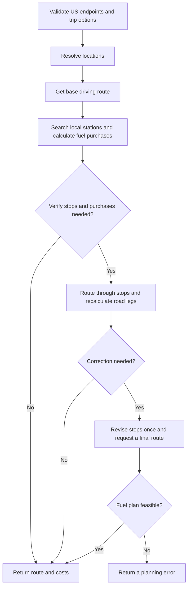
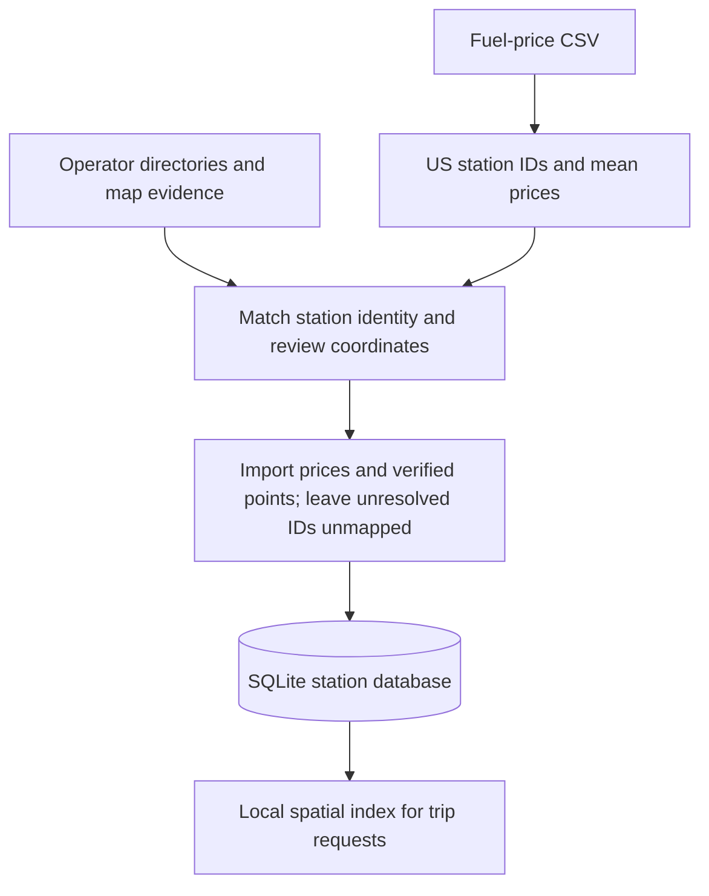

# Fuel Route Planner

A Django API that returns a US driving route, fuel stops, purchase quantities,
and fuel cost in USD. The response includes GeoJSON. The page at `/` displays
the route and itemized purchases with Leaflet. Provider keys stay on the server.

## Run locally

Use Python 3.12 to 3.14 and [uv](https://docs.astral.sh/uv/). From the project directory,
install dependencies. Copy `.env.example` only if `.env` does not already exist:

```powershell
uv sync --locked
if (-not (Test-Path -LiteralPath .env)) {
    Copy-Item -LiteralPath .env.example -Destination .env
}
```

Set `ORS_API_KEY` in `.env` to a free
[HeiGIT Standard API key](https://account.heigit.org/).
Environment variables take precedence over `.env`.

```powershell
uv run python manage.py migrate
uv run python manage.py import_fuel_prices --coordinates data/verified-station-coordinates.csv --replace-coordinates
uv run python manage.py runserver
```

The import reads `fuel-prices-for-be-assessment.csv` by default and makes no
network requests. `--replace-coordinates` treats the supplied mapping as complete;
it clears older coordinates for IDs omitted from the file. Invalid imports roll
back without changing the dataset.

Open `http://127.0.0.1:8000/`. `GET /api/health/` reports provider configuration,
dataset revision, and station coverage.

## Vehicle values and configurable defaults

| Fixed vehicle value | Value |
| --- | --- |
| Maximum range | 500 miles |
| Fuel efficiency | 10 miles per US gallon |
| Tank capacity | 50 gallons (`500 / 10`) |

Only `start` and `finish` are required. Each optional value can be set per request;
the environment variable sets its application default.

| Request field | Default | Allowed values | Environment variable |
| --- | --- | --- | --- |
| `initial_fuel_gallons` | 50 gallons | Greater than 0, at most 50; 7 decimal places | `DEFAULT_INITIAL_FUEL_GALLONS` |
| `initial_fuel_price_usd_per_gallon` | $0/gal | 0 to 1000; 8 decimal places | `DEFAULT_INITIAL_FUEL_PRICE_USD` |
| `verify_stops` | `true` | JSON boolean | `DEFAULT_VERIFY_STOPS` |
| `station_corridor_miles` | 2 miles | Greater than 0, at most 20; 6 decimal places | `DEFAULT_STATION_CORRIDOR_MILES` |

## Trip flow



Coordinate endpoints skip geocoding. All station selection and fuel calculations
run locally. Verification uses the road distance of every leg, including detours
to stations. The correction can replace an unreachable stop chain or remove
unused waypoints. The service returns an error if it cannot verify a feasible
plan within the request budget.

## API contract

Send `POST /api/routes/` with `Content-Type: application/json`:

```json
{
  "start": "Oklahoma City, OK",
  "finish": {"latitude": 32.7767, "longitude": -96.7970},
  "initial_fuel_gallons": "50",
  "initial_fuel_price_usd_per_gallon": "0",
  "verify_stops": true,
  "station_corridor_miles": "2"
}
```

Each endpoint accepts text, `{"address": "Dallas, TX"}`, or numeric `latitude`
and `longitude` fields. Text must contain 1 to 300 characters. Fuel, price, and
corridor values accept JSON numbers or decimal strings. Unknown fields are rejected.

| Response field | Contents |
| --- | --- |
| `start`, `finish` | Resolved labels and coordinates |
| `route` | GeoJSON LineString, miles, duration, and itinerary station IDs |
| `fuel.stops` | Station identity and location, mean price, gallons purchased, arrival/departure fuel, and itemized cost |
| `fuel` | Initial, purchased, consumed, and remaining fuel; purchase cost and total cost |
| `planning` | Verification result, distance model, corridor, correction use, and cost policy |
| `metadata` | Provider attempts, cache hits, dataset revision, and station coverage |

GeoJSON uses WGS84 **[longitude, latitude]** order. Decimal quantities and USD
amounts are strings. Each purchase and the initial fuel value are rounded half
up to cents; totals sum those amounts.

`total_cost_usd = initial_fuel_cost_usd + purchase_cost_usd`.
The initial value is the full starting quantity multiplied by its configured
price, including fuel remaining at arrival. `purchase_cost_usd` is the money
spent at stops during this trip. With the default starting price of zero, the
two totals are equal.

With verification disabled, the map follows the base route and shows nearby
station markers; distance and cost exclude station detours. With verification
enabled, the geometry passes through selected waypoints and fuel uses road-leg
distances. After the final correction, an unused waypoint can remain in
`route.via_station_ids` while `fuel.stops` contains only actual purchases.

Planning errors contain `error.code`, `error.message`, `error.details`, and call metadata.
Invalid input returns 400; unsupported methods/media return 405/415; bodies over
16 KiB return 413. Non-US or ambiguous locations, unreachable fuel chains, and
provider route limits return 422. Invalid upstream responses return 502;
configuration, network, and quota failures return 503; upstream timeouts return
504. A failed verification is never returned as a successful unverified plan.

## Provider calls and cache

[HeiGIT](https://api.heigit.org/) supplies openrouteservice directions and Pelias
geocoding under one key.

| When a response is not cached | Provider operation | Maximum attempts per trip |
| --- | --- | --- |
| Text start and/or finish | `GET /pelias/v1/search` | 0 to 2 total |
| Base route | `POST /openrouteservice/v2/directions/driving-car/geojson` | 1 |
| Verification through fuel stops | Same directions endpoint | 1 |
| Final correction | Same directions endpoint | 1 |

A cold trip normally uses one routing call, or two when fuel stops need
verification. The maximum is three attempted routing calls. Cache hits make no
external call. There are no automatic HTTP retries; response metadata reports
attempts and cache hits separately.

The persistent file cache lives in `.cache/responses`. Routes expire after 24
hours and geocodes after 30 days. Keys include exact ordered route coordinates
or normalized text, plus provider options. Prices come from the current local
dataset. HTTP connections are reused within a trip;
simultaneous cold requests can still miss the cache independently.

Text geocoding is restricted to US results from OpenStreetMap, OpenAddresses,
and GeoNames. City queries must match the city name and supplied state. Street
addresses cannot silently fall back to cities. Low-confidence or ambiguous
results are rejected. Source selection avoids boundary centroids and adds no
requests; see [Pelias source filtering](https://github.com/pelias/documentation/blob/master/search.md#filter-by-data-source).

All waypoints must snap to a drivable road within 350 metres. Returned geometry
is checked against that limit. Provider road distances exclude unmapped driving
inside station premises. See the [snapping limit](https://giscience.github.io/openrouteservice/v9.10.0/frequently-asked-questions)
and [routing restrictions](https://openrouteservice.org/restrictions/).
Requests support at most 50 waypoints, including the start and finish. Driving
routes are limited to 6,000 km; account quotas apply separately.

The browser fetches [USGS National Map tiles](https://basemap.nationalmap.gov/arcgis/rest/services/USGSTopo/MapServer)
to draw the background. These are separate from routing/geocoding requests and
need no tile key. Leaflet assets are served locally with their license.
`MAP_TILE_URL` and `MAP_TILE_ATTRIBUTION` can select another authorized XYZ service.

## Station preparation and coverage

Station preparation runs separately from trip requests. The supplied CSV has
prices and station identities but no coordinates.



Duplicate prices use the arithmetic mean of all CSV observations. Reviewed
aliases of one physical station appear once, with prices weighted by observation
count. Sites with recorded closure or conflicting availability evidence are excluded. City
centers, highway exits, and raw
street-geocoder matches are search leads; they are not accepted station points.

The reviewed mapping covers **5,523 of 6,626 US station IDs**. The remaining
**1,103** are unresolved; exclusions and physical aliases leave **5,504 routable
sites**. See [the coordinate report](data/station-coordinate-report.md) for method
counts, evidence, and limits. `/api/health/` reports the imported dataset's coverage.

Price reimports preserve coordinates only when the address is unchanged. Address
changes clear stale mappings; missing IDs become inactive. Coordinate files can
bind points to `address`, `city`, and `state`, and mismatches reject the import.
`verified` defaults to false when omitted.

The submission includes the prepared mapping and selected audit evidence. It
does not include the full research cache. The app and test suites need no research
downloads. To rebuild the mapping and report, retain the local research inputs
and use the tools in `scripts/coordinates/`:

```powershell
uv sync --locked --group data
uv run python -m scripts.coordinates.merge
uv run python -m scripts.coordinates.coverage_report
```

These commands use saved evidence. Acquisition tools require explicit network
flags. TomTom is used only for offline station research, not trip requests.
Location evidence does not establish current prices, fuel grade, or payment
eligibility. The planner treats the supplied prices as comparable USD per gallon.

Git retains eight data files: the coordinate mapping, reports, final station
evidence, unresolved identities, status and alias reviews, and one live validation
record. These are final outputs. Research intermediates, duplicate summaries and
historical debugging records remain local and are ignored. Only
`data/verified-station-coordinates.csv` is required from `data/` to import the mapping.

## Optimization and limits

A spatial index narrows stations to the route corridor before calculating
distances. A second index covers route segments, so proximity is measured to
segment interiors rather than only vertices. Station progress is projected onto
the route and calibrated to provider distance.

For `k` candidate stations, sorting costs `O(k log k)` and purchasing costs `O(k)`.
The greedy rule buys enough to reach a cheaper station within range; otherwise
it fills the tank or buys just enough to finish. This is exact for a fixed ordered
itinerary with fractional gallons and linear prices. There is no minimum purchase
or arbitrary station shortlist.

Road-route selection remains approximate. A station near the geometry may require
a detour, and sparse mappings can leave no reachable fuel chain. Verification
checks the chosen itinerary; it does not compare every alternate road and station.
`globally_optimal_road_route` is therefore always false. Coordinates still require
a nearby drivable road, and similarly named cities may need a state or fuller address.

## Tests and deployment

```powershell
uv run python manage.py check
uv run python manage.py test
uv run --group data python -m unittest discover -s scripts/coordinates -p "test_*.py"
uv run ruff check .
uv run ruff format --check .
```

Tests cover an independent exhaustive fuel-state solver on generated cases,
fuel conservation and capacity, decimal rounding, segment projection, US
validation, duplicate prices, atomic imports, provider errors/cache/budgets,
city geocoding, and full API verification/correction. Tests use mocked transport
and sanitized provider fixtures; they need no key and make no live HTTP requests.

[The recorded live validation](data/live-verified-stations/validation.json)
contains actual requests, timings, quota headers, and fuel checks. Repeat bounded
provider checks with `uv run python -m scripts.validate_live --network`: at most
12 requests, four-second spacing, and a stop on failure or authentication/quota
errors. `--cached-only` disables HTTP and stop verification; it checks fuel
accounting against saved base routes and fails if a cache entry is missing.

The API is anonymous and stateless; its JSON planning endpoint is CSRF-exempt.
Before public deployment, add access/rate controls that protect the provider
quota. Set `DJANGO_DEBUG=false`, a private `DJANGO_SECRET_KEY`, and explicit
`DJANGO_ALLOWED_HOSTS`. Serve static files and use a WSGI/ASGI server with HTTPS.
Provider requests time out after 12 seconds each. Django 6.1.2 is pinned in
`pyproject.toml` and `uv.lock`.
